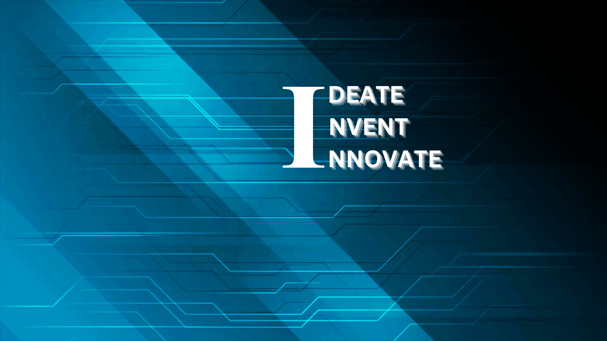

# School-Management

    

## 📑 Table of Contents

- [Description](#description)
- [Screenshots](#screenshots)
- [Quick Start](#quick-start)
- [Project Structure](#project-structure)
- [Contributors](#contributors)
- [Contributing](#contributing)
- [License](#license)

## 📝 Description

School-Management — a software project built with modern tooling.

## 📸 Screenshots




## ⚡ Quick Start

```bash

# 1. Clone the repository
git clone https://github.com/Shegin733/School-Management.git

# See the Development Setup section below
```

## 📁 Project Structure

```
.
├── LICENSE
├── authorize_management
│   ├── admin_dashboard
│   │   ├── __init__.py
│   │   ├── admin.py
│   │   ├── apps.py
│   │   ├── migrations
│   │   │   ├── 0001_initial.py
│   │   │   └── __init__.py
│   │   ├── models.py
│   │   ├── permissions.py
│   │   ├── serializers.py
│   │   ├── urls.py
│   │   └── views.py
│   ├── authorize_management
│   │   ├── __init__.py
│   │   ├── asgi.py
│   │   ├── settings.py
│   │   ├── urls.py
│   │   └── wsgi.py
│   ├── common
│   │   ├── __init__.py
│   │   ├── apps.py
│   │   ├── migrations
│   │   │   ├── 0001_initial.py
│   │   │   ├── 0002_alter_libraryhistory_book_id.py
│   │   │   └── __init__.py
│   │   ├── models.py
│   │   ├── serializers.py
│   │   ├── urls.py
│   │   └── views.py
│   ├── db.sqlite3
│   ├── librarian_dashboard
│   │   ├── __init__.py
│   │   ├── apps.py
│   │   ├── forms.py
│   │   ├── migrations
│   │   │   └── __init__.py
│   │   ├── models.py
│   │   ├── serializers.py
│   │   ├── urls.py
│   │   └── views.py
│   ├── manage.py
│   ├── media
│   │   └── administrator_photos
│   │       ├── IDEATE.INVENT.INNOVATE_2.png
│   │       ├── IDEATE_3hTZupC.INVENT.INNOVATE_2.png
│   │       └── IDEATE_Rzr8XVh.INVENT.INNOVATE_2.png
│   └── office_staff_dashboard
│       ├── __init__.py
│       ├── apps.py
│       ├── forms.py
│       ├── migrations
│       │   └── __init__.py
│       ├── models.py
│       ├── serializers.py
│       ├── urls.py
│       └── views.py
└── requirement.txt
```

## 👥 Contributors

Thanks to everyone who has contributed to this project:

<p align="left">
<a href="https://github.com/Shegin733" title="Shegin733"></a>
</p>

[See the full list of contributors →](https://github.com/Shegin733/School-Management/graphs/contributors)

## 👥 Contributing

Contributions are welcome! Here's the standard flow:

1. **Fork** the repository
2. **Clone** your fork: `git clone https://github.com/Shegin733/School-Management.git`
3. **Branch**: `git checkout -b feature/your-feature`
4. **Commit**: `git commit -m 'feat: add some feature'`
5. **Push**: `git push origin feature/your-feature`
6. **Open** a pull request

Please follow the existing code style and include tests for new behavior where applicable.

## 📜 License

This project is licensed under the **MIT** License.

---

<div align="center">

[](https://readmebuddy.com)

<sub>Generate beautiful READMEs in seconds → <a href="https://readmebuddy.com">readmebuddy.com</a></sub>

</div>
# School Management System with Role-Based Access Control

A robust **School Management System** built using **Django**, featuring **Role-Based Access Control (RBAC)**. This system enables multiple user roles—**Admin**, **Office Staff**, and **Librarian**—to manage students, fees, and library records efficiently.

---

## **Table of Contents**  
1. [Project Overview](#project-overview)  
2. [Features](#features)  
3. [Technologies Used](#technologies-used)  
5. [Setup Instructions](#setup-instructions)  
6. [Environment Variables](#environment-variables)  
7. [Roles & Permissions](#roles--permissions)    
8. [Design Presentation](#design-presentation)

---

## **Project Overview**  
The School Management System is designed to perform CRUD operations on **Student Details**, **Fees Records**, and **Library Records** with user-specific permissions.  
It incorporates Role-Based Access Control (RBAC) to restrict functionalities for **Admin**, **Office Staff**, and **Librarians**.  

---

## **Features**

### **Authentication**  
- Secure user login system using Django's built-in **authentication framework**.  
- RBAC implemented via Django **Groups and Permissions**.  

### **Admin Dashboard**  
- Manage (create, edit, delete) Office Staff and Librarian accounts.  
- CRUD operations for **Student Details**, **Fees History**, and **Library History**.  

### **Office Staff Dashboard**  
- View all **Student Details**.  
- Manage (add, edit, delete) **Fees Records**.  
- View Library History.  

### **Librarian Dashboard**  
- **View-only** access to **Student Details** and **Library History**.  

### **Student Management**  
- Full CRUD operations on Student Details. 

### **Additional Features**  
- Reconfirmation prompts for critical actions using **Django Messages**.  
- Enhanced validation checks to ensure data integrity.  

---

## **Technologies Used**  
- **Backend**: Django 4.x (MVC architecture)  
- **Database**: SQLite3 (default, can be changed to PostgreSQL/MySQL)   
- **Authentication**: Django Authentication Framework  
- **Role Management**: Django Permissions   

---

## **Setup Instructions**

Follow these steps to set up and run the project locally:

### **1. Clone the Repository**  

### **2. Set Up a Virtual Environment**  
```bash
python -m venv env
source env/bin/activate   # For Linux/Mac
env\Scripts\activate      # For Windows
```

### **3. Install Dependencies**  
```bash
pip install -r requirements.txt
```

### **4. Apply Migrations**  
```bash
python manage.py makemigrations
python manage.py migrate
```

### **5. Create Superuser**  
```bash
python manage.py createsuperuser
```
### **6. Add Email Backend in settings.py** 
### **7. Run the Server**  
```bash
python manage.py runserver
```

Access the application at `http://127.0.0.1:8000/`.

---

## **Environment Variables**

Create a `.env` file at the project root with the following content:  

```dotenv
SECRET_KEY='your_django_secret_key'
DEBUG=True
ALLOWED_HOSTS=127.0.0.1, localhost
```

---

## **Roles & Permissions**

### **Admin**  
- Full access to the system.  
- Manage Office Staff, Librarians, Students, Fees, and Library Records.  

### **Office Staff**  
- View all student details.  
- Manage Fees Records.  
- View Library Records.  

### **Librarian**  
- View-only access to Library and Student Details.  

## **Libraries Used**  

- **Django**: Web framework.  
- **django-environ**: Environment variable management.  
- **SQLite**: Default database.  

## **Design Presentation**

For an overview of the design presentation, view it on Canva: [School Management System Design](https://www.canva.com/design/DAGZh6hluos/ShiFGwet_cdtWBYoUIEFVQ/view?utm_content=DAGZh6hluos&utm_campaign=designshare&utm_medium=link2&utm_source=uniquelinks&utlId=h114926ae57).
This is just abstract design and not absolute
## **License**  
This project is licensed under the MIT License.  

---
